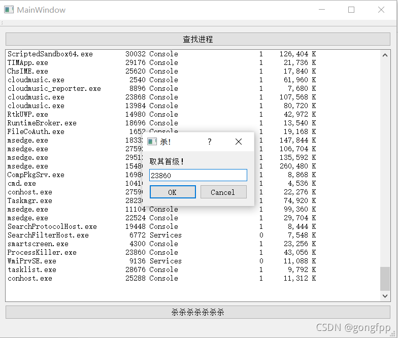

# ProcessKiller

> 一个基于 Qt Widgets 的 Windows 小工具：查看运行中的进程，并通过 PID 请求结束进程。

<p align="center">
  
</p>

<p align="center"><sub>截图取自本 README 原先引用的 <a href="https://img-blog.csdnimg.cn/47d72e90c4df4507844a610eaed40edf.png?x-oss-process=image/watermark,type_ZHJvaWRzYW5zZmFsbGJhY2s,shadow_50,text_Q1NETiBAZ29uZ2ZwcA==,size_20,color_FFFFFF,t_70,g_se,x_16">CSDN 原图</a>，保留原站水印。这是已有截图，不是本次文档更新期间重新运行程序后截取的。</sub></p>

## 功能

- **查看进程：** 调用 Windows `tasklist.exe`，并在窗口中显示输出。
- **按 PID 结束进程：** 弹出输入框，读取 PID 后调用 `taskkill`。
- **避免界面阻塞：** 通过 Qt 线程池执行进程列表查询。

## 构建与运行

### 环境要求

- Windows（程序调用 `tasklist.exe` 和 `taskkill`）。
- **推荐 Qt 5** 与 Qt Creator，以及包含 **Qt Widgets** 的 Windows Desktop Kit；编译器需与所选 Qt Kit 匹配（MSVC 或 MinGW）。源码包含 `QTextCodec`，而 `.pro` 未启用 Qt 6 的 Core5Compat；Qt 6 Kit 不能直接按当前配置构建。
- 项目使用 qmake（`ProcessKiller.pro`）并启用 C++11。

### 使用 Qt Creator

1. 在 Qt Creator 中打开 `ProcessKiller.pro`。
2. 选择并配置已安装的 Windows Desktop Kit。
3. 构建项目，然后在 Qt Creator 中运行。

### 使用命令行

在与 Qt Kit 匹配的开发者命令行中运行 qmake，再使用该 Kit 对应的 make 工具：

```bat
mkdir build
cd build
qmake ..\ProcessKiller.pro
mingw32-make
```

若使用 MSVC Kit，请在对应的 Qt/MSVC 环境中运行 qmake，并将 `mingw32-make` 替换为 `nmake`。

## 使用方法

1. 点击 **查找进程**，刷新进程列表。
2. 找到目标进程并记下 PID。
3. 点击结束进程按钮，在对话框中输入目标 PID 并确认。

## 安全提示

- 当前实现未检查 PID 对话框的确认/取消状态；点击 **Cancel** 后仍会继续调用 `taskkill`，并传入空 PID。不要把 Cancel 当作可靠的取消操作。
- 对话框接收的是 PID，不会自动选中或校验列表中的某一行。确认前请核对 PID 和进程名。
- 可以输入 ProcessKiller 自身的 PID 并关闭程序；截图展示的就是这一情形。
- Windows 可能拒绝结束受保护或以更高权限运行的进程。不要尝试结束 Windows 系统进程；误操作可能关闭应用或影响系统稳定性。

## 已知限制

- 进程列表是 `tasklist` 的纯文本输出；没有搜索、筛选、排序或进程详情视图。
- 仓库未附预编译发布包，也没有自动化测试套件。
